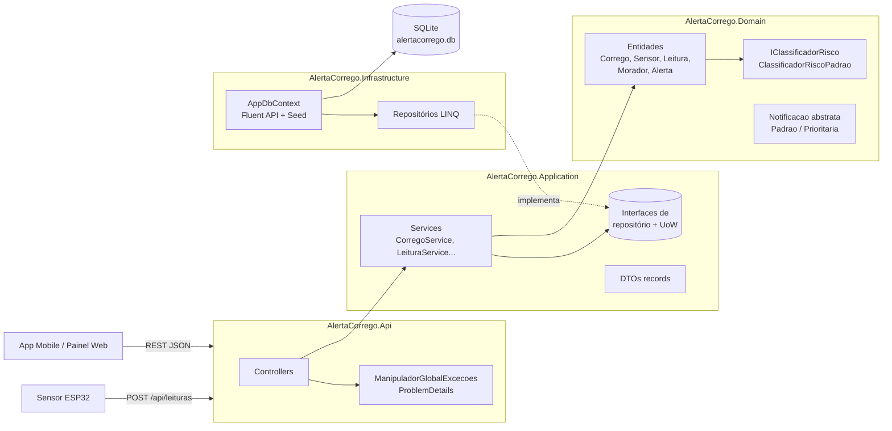
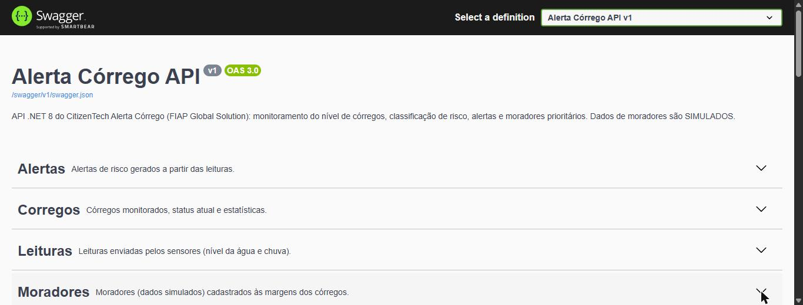

# Alerta Córrego — Web API .NET 8 (C# Software Development)

> FIAP Global Solution — CitizenTech **Alerta Córrego** · Parte **C#**: Web API .NET 8 com EF Core, LINQ, async/await e testes unitários.

## Ficha da CitizenTech — Alerta Córrego

| Campo | Preenchimento |
|---|---|
| **Nome da CitizenTech** | Alerta Córrego |
| **Cidade e bairro** | São Paulo — M'Boi Mirim (Zona Sul) |
| **Cidadão beneficiado** | Morador de rua às margens de córrego com risco de alagamento, com prioridade para idosos e pessoas com mobilidade reduzida |
| **Problema, em uma frase** | Moradores de ruas às margens de córregos pequenos recebem o alerta de chuva da Defesa Civil para a região inteira, mas não sabem quando o córrego da rua deles vai transbordar, e quem tem mobilidade reduzida depende de vizinhos para sair a tempo. |
| **Como funciona** | Um ESP32 no córrego mede o nível da água e a chuva e publica via MQTT. Um servidor Linux recebe as leituras, classifica o risco (Normal / Atenção / Evacuar) e mostra um painel web com a rede de apoio aos moradores prioritários. Um modelo de ML antecipa temporais, e os dados sensíveis dos moradores são auditados e protegidos. |
| **Diferencial** | Complementa a Defesa Civil: o alerta oficial avisa que vai chover na região; o Alerta Córrego avisa que a água está subindo naquela rua e quem precisa de ajuda primeiro. |
| **O que cada parte faz** | **Physical Computing:** estação ESP32 no Wokwi (nível do córrego, chuva, LEDs, sirene, LCD, MQTT) · **Operating Systems:** servidor Linux provisionado por Shell Script, monitorado e tolerante a falhas, que hospeda o painel · **IA & ML:** XGBoost que prevê chuva forte nas próximas 3 h para antecipar o alerta · **Cybersecurity:** CitizenGuard, que detecta dados pessoais e sensíveis, rastreia vazamentos (taint analysis), traduz falhas em alertas por IA e mede o Risco Cidadão |
| **Link do repositório** | **C# (este repositório): https://github.com/fabriciomunix/Gs-c-** · Mobile: https://github.com/fabriciomunix/GS-Mobile · SOA: https://github.com/fabriciomunix/Gs-soa · QA: https://github.com/fabriciomunix/GS-QA |
| **Indicador de impacto** | Minutos de antecedência entre o alerta e o transbordamento; nº de moradores prioritários alertados; Risco Cidadão dos dados cadastrados |
| **ODS conectados** | ODS 11 (cidades resilientes, meta 11.5) · ODS 13 (adaptação ao clima, meta 13.1) · ODS 10 (inclusão de idosos e PcD) |

### Integrantes

- Fabricio Carlos Duarte Rossi Junior — RM 555017
- Arnaldo Filho — RM 555780

---

## Descrição da solução

Esta API recebe as leituras do sensor ESP32 instalado no córrego (nível da água em cm e chuva em mm/h), **classifica o risco** com a regra comum do projeto, **gera alertas** quando o risco é ALERTA ou CRITICO e devolve, na mesma resposta, a **lista de moradores prioritários** (acamados, cadeirantes, idosos...) que precisam de ajuda para sair — ordenada do mais ao menos urgente — e as notificações a enviar para todos os moradores daquele córrego.

O app mobile e o painel web consomem os endpoints de status, leituras, alertas e moradores. O contrato REST e o modelo de domínio são **os mesmos da API SOA (FastAPI)**.

### Regra de classificação de risco (igual em todas as partes)

| Condição (nível em cm, chuva em mm/h) | Risco |
|---|---|
| nível ≥ `nivelCriticoCm` | `CRITICO` |
| nível ≥ `nivelAlertaCm` | `ALERTA` |
| nível ≥ 0,75 × `nivelAlertaCm` **ou** chuva ≥ 30 mm/h | `ATENCAO` |
| caso contrário | `NORMAL` |

Implementada em [`ClassificadorRiscoPadrao`](src/AlertaCorrego.Domain/Risco/ClassificadorRiscoPadrao.cs) (Strategy) e coberta por testes `[Theory]` em todos os limites.

### Tecnologias

- .NET 8 / C# 12 · ASP.NET Core Web API (Controllers)
- Entity Framework Core 8 + SQLite (`Microsoft.EntityFrameworkCore.Sqlite 8.0.11`)
- Swagger / OpenAPI (`Swashbuckle.AspNetCore 6.9.0`) com comentários XML
- xUnit 2.9 + Moq 4.20 (testes unitários)

---

## Arquitetura em camadas



Dependências entre projetos (a regra de negócio não depende de infraestrutura):

```
Api ──► Application ──► Domain
 └────► Infrastructure ──► Application
Tests ──► Application, Domain
```

### Estrutura de pastas

```
AlertaCorrego.sln
src/
  AlertaCorrego.Domain/          Entidades, enums, regra de risco, notificações, exceções de domínio
  AlertaCorrego.Application/     DTOs (records), interfaces, serviços (casos de uso), mapeamentos
  AlertaCorrego.Infrastructure/  AppDbContext, Configurations (Fluent API), Seed, repositórios, DI
  AlertaCorrego.Api/             Program.cs, Controllers, tratamento global de exceções, Swagger
tests/
  AlertaCorrego.Tests/           Testes de domínio e de serviços (xUnit + Moq)
docs/evidencias/                 Prints do Swagger e dos testes
```

---

## Conceitos aplicados × critérios de avaliação

| Critério | Onde está no código |
|---|---|
| **POO — encapsulamento** | Entidades com `private set`, construtor privado para o EF e construtores públicos que validam invariantes ([`Corrego`](src/AlertaCorrego.Domain/Entidades/Corrego.cs): nível crítico > nível de alerta; [`Morador`](src/AlertaCorrego.Domain/Entidades/Morador.cs): telefone normalizado, prioridade automática; [`Leitura`](src/AlertaCorrego.Domain/Entidades/Leitura.cs): faixas válidas). Validações centralizadas em [`Guarda`](src/AlertaCorrego.Domain/Comum/Guarda.cs). |
| **POO — comportamento nas entidades** | `Corrego.AvaliarRisco(nivel, chuva)`, `Leitura.ClassificarRisco(corrego)`, `Sensor.RegistrarLeitura(...)` (bloqueia sensor inativo), `Alerta.Gerar(...)` (fábrica) e `Alerta.Encerrar()` (não encerra duas vezes). |
| **POO — herança** | [`EntidadeBase`](src/AlertaCorrego.Domain/Comum/EntidadeBase.cs) abstrata (Id, CriadoEm); [`DominioException`](src/AlertaCorrego.Domain/Excecoes/DominioException.cs) abstrata → `ValidacaoDominioException`, `EntidadeNaoEncontradaException`, `RegraNegocioException`; [`RepositorioBase<T>`](src/AlertaCorrego.Infrastructure/Repositorios/RepositorioBase.cs) herdado pelos repositórios. |
| **POO — polimorfismo** | [`Notificacao`](src/AlertaCorrego.Domain/Notificacoes/Notificacao.cs) abstrata com `NotificacaoPadrao` e `NotificacaoPrioritaria` (sobrescrevem `Prioridade` e `MontarMensagem()`); Strategy [`IClassificadorRisco`](src/AlertaCorrego.Domain/Risco/IClassificadorRisco.cs) / `ClassificadorRiscoPadrao`. |
| **Interfaces e DI** | Serviços (`ICorregoService`, `ISensorService`, `ILeituraService`, `IMoradorService`, `IAlertaService`) e repositórios (`IRepositorio<T>`, `ICorregoRepositorio`..., `IUnidadeDeTrabalho`) em [`Application/Interfaces`](src/AlertaCorrego.Application/Interfaces). Registro via `AddApplication()` e `AddInfrastructure(config)`. `TimeProvider` injetado para testabilidade. |
| **Web API** | 5 controllers em [`Api/Controllers`](src/AlertaCorrego.Api/Controllers) seguindo o contrato da Ficha; `[ApiController]`, `ProducesResponseType`, `201 CreatedAtAction`, `204 NoContent`, `400 ValidationProblem`, `404`, `409`; [`ManipuladorGlobalExcecoes`](src/AlertaCorrego.Api/Middleware/ManipuladorGlobalExcecoes.cs) (`IExceptionHandler`) converte exceções de domínio em `ProblemDetails`; CORS para o app; JSON camelCase com enums em texto (`"CRITICO"`). |
| **EF Core** | [`AppDbContext`](src/AlertaCorrego.Infrastructure/Persistencia/AppDbContext.cs) + uma classe de Fluent API por entidade em [`Configurations/`](src/AlertaCorrego.Infrastructure/Persistencia/Configurations) (chaves, tamanhos, índices, enums como texto, relacionamentos 1‑N com cascata) e seed `HasData` em [`DadosIniciais`](src/AlertaCorrego.Infrastructure/Persistencia/Seed/DadosIniciais.cs). |
| **LINQ** | [`LeituraRepositorio`](src/AlertaCorrego.Infrastructure/Repositorios/LeituraRepositorio.cs): `Where` + `OrderByDescending` + `Take` + projeção `Select` para DTO; `GroupBy` por nível de risco com `Count/Sum/Max/Min` (estatísticas). `Include` em [`SensorRepositorio`](src/AlertaCorrego.Infrastructure/Repositorios/SensorRepositorio.cs). LINQ to Objects nos serviços (ordenação de prioritários por urgência, agregação das estatísticas). |
| **Async/Await** | Toda a pilha é assíncrona (`Task`, `ToListAsync`, `FirstOrDefaultAsync`, `SaveChangesAsync`, `EnsureCreatedAsync`) com `CancellationToken` propagado do controller até o banco. |
| **Testes** | [`tests/AlertaCorrego.Tests`](tests/AlertaCorrego.Tests): regra de risco com `[Theory]/[InlineData]` em todos os limites, invariantes das entidades, polimorfismo das notificações e serviços com repositórios mockados (Moq) — leitura crítica gera alerta e lista prioritários ordenados; leitura normal não gera alerta; 404/409. |
| **Qualidade / LGPD** | Camadas separadas, nomes no domínio (português), `sealed`, nullable habilitado, documentação XML. Dados de moradores são **fictícios**; logs registram apenas ids e contagens — nunca nome, telefone ou endereço. |

---

## Como rodar

Pré‑requisito: [.NET 8 SDK](https://dotnet.microsoft.com/download/dotnet/8.0).

```bash
git clone https://github.com/fabriciomunix/Gs-c-.git
cd Gs-c-
dotnet restore
dotnet run --project src/AlertaCorrego.Api
```

Abra **http://localhost:5080/swagger** (a raiz `/` redireciona para o Swagger).

Na primeira execução o banco SQLite `alertacorrego.db` é criado automaticamente (`EnsureCreatedAsync`) com os dados de seed:

- 2 córregos: **Córrego Ponte Baixa** (M'Boi Mirim — alerta 120 cm / crítico 180 cm) e **Córrego Morro do S** (Campo Limpo — 100 / 150 cm)
- 1 sensor por córrego: `ESP32-PB-01` (id 1) e `ESP32-MS-01` (id 2)
- 6 moradores fictícios (3 prioritários: idoso, cadeirante, acamado)
- 7 leituras e 1 alerta histórico (encerrado)

Para recriar o banco do zero, apague o arquivo `src/AlertaCorrego.Api/alertacorrego.db` (ou o `.db` na pasta onde a API foi executada).

> **Migrations (opcional):** o projeto usa `EnsureCreated` para facilitar a correção. Para usar migrations:
> ```bash
> dotnet tool install --global dotnet-ef --version 8.0.11
> dotnet ef migrations add Inicial --project src/AlertaCorrego.Infrastructure --startup-project src/AlertaCorrego.Api
> ```
> e troque `EnsureCreatedAsync()` por `MigrateAsync()` em `InicializarBancoDeDadosAsync`.

A connection string fica em `src/AlertaCorrego.Api/appsettings.json` (`ConnectionStrings:AlertaCorrego`). Origens de CORS podem ser restringidas em `Cors:OrigensPermitidas` (vazio = qualquer origem, para o app em desenvolvimento).

## Como testar

```bash
dotnet test
```

Também há exemplos prontos em [`src/AlertaCorrego.Api/AlertaCorrego.Api.http`](src/AlertaCorrego.Api/AlertaCorrego.Api.http) (VS / VS Code REST Client / Rider).

---

## Endpoints (base `/api`)

| Método | Rota | Descrição | Respostas |
|---|---|---|---|
| GET | `/api/corregos` | Lista córregos | 200 |
| POST | `/api/corregos` | Cadastra córrego | 201, 400 |
| GET | `/api/corregos/{id}` | Obtém córrego | 200, 404 |
| PUT | `/api/corregos/{id}` | Atualiza córrego | 200, 400, 404 |
| DELETE | `/api/corregos/{id}` | Remove córrego (cascata) | 204, 404 |
| GET | `/api/corregos/{id}/status` | Último nível, chuva, nível de risco, última leitura e nº de alertas ativos | 200, 404 |
| GET | `/api/corregos/{id}/estatisticas?horas=24` | Média/máx./mín. do nível, chuva máx. e contagem por risco na janela | 200, 400, 404 |
| GET | `/api/sensores?corregoId=` | Lista sensores | 200 |
| POST | `/api/sensores` | Cadastra sensor | 201, 400, 404, 409 |
| GET | `/api/sensores/{id}` | Obtém sensor | 200, 404 |
| POST | `/api/leituras` | Registra leitura → leitura + nivelRisco + alerta (se houver) + prioritários + notificações | 201, 400, 404, 409 |
| GET | `/api/leituras?corregoId=&limite=` | Últimas leituras (limite 1–500, padrão 50) | 200, 400 |
| GET | `/api/moradores?corregoId=` | Lista moradores | 200 |
| POST | `/api/moradores` | Cadastra morador | 201, 400, 404 |
| GET | `/api/moradores/{id}` | Obtém morador | 200, 404 |
| PUT | `/api/moradores/{id}` | Atualiza morador | 200, 400, 404 |
| DELETE | `/api/moradores/{id}` | Remove morador | 204, 404 |
| GET | `/api/moradores/prioritarios?corregoId=` | Prioritários, do mais ao menos urgente | 200, 404 |
| GET | `/api/alertas?ativos=true&corregoId=` | Lista alertas | 200 |
| PATCH | `/api/alertas/{id}/encerrar` | Encerra alerta | 200, 404, 409 |

Erros seguem o padrão **ProblemDetails** (RFC 7807), por exemplo:

```json
{
  "title": "Dados inválidos",
  "status": 400,
  "detail": "O nível crítico deve ser maior que o nível de alerta.",
  "errors": { "nivelCriticoCm": ["O nível crítico deve ser maior que o nível de alerta."] },
  "instance": "/api/corregos",
  "traceId": "0HN..."
}
```

## Exemplos de requisição

**Registrar leitura crítica (sensor do Córrego Ponte Baixa):**

```bash
curl -X POST http://localhost:5080/api/leituras \
  -H "Content-Type: application/json" \
  -d '{ "sensorId": 1, "nivelAguaCm": 185, "chuvaMmHora": 48 }'
```

Resposta `201 Created` (resumida):

```json
{
  "leitura": { "id": 8, "sensorId": 1, "corregoId": 1, "nivelAguaCm": 185, "chuvaMmHora": 48, "nivelRisco": "CRITICO", "registradaEm": "2026-11-19T21:10:00Z" },
  "nivelRisco": "CRITICO",
  "alerta": { "id": 2, "corregoId": 1, "nivelRisco": "CRITICO", "mensagem": "RISCO CRÍTICO: Córrego Ponte Baixa atingiu 185 cm (limite crítico 180 cm). ...", "nivelAguaCm": 185, "ativo": true, "encerradoEm": null },
  "moradoresPrioritarios": [
    { "id": 2, "nome": "João Batista (fictício)", "tipoNecessidade": "CADEIRANTE", "prioritario": true },
    { "id": 1, "nome": "Maria Aparecida (fictícia)", "tipoNecessidade": "IDOSO", "prioritario": true }
  ],
  "notificacoes": [
    { "moradorId": 2, "tipo": "PRIORITARIA", "prioridade": 13, "mensagem": "[PRIORIDADE] RISCO CRÍTICO: ..." },
    { "moradorId": 1, "tipo": "PRIORITARIA", "prioridade": 12, "mensagem": "[PRIORIDADE] RISCO CRÍTICO: ..." },
    { "moradorId": 3, "tipo": "PADRAO", "prioridade": 0, "mensagem": "RISCO CRÍTICO: ... Se puder, verifique se algum vizinho precisa de ajuda." }
  ]
}
```

**Status do córrego:**

```bash
curl http://localhost:5080/api/corregos/1/status
```

**Cadastrar morador (dados fictícios):**

```bash
curl -X POST http://localhost:5080/api/moradores \
  -H "Content-Type: application/json" \
  -d '{ "nome": "Morador Teste (fictício)", "telefone": "(11) 90000-0099", "endereco": "Rua Fictícia, 99", "corregoId": 1, "prioritario": false, "tipoNecessidade": "CADEIRANTE" }'
```

**Alertas ativos e encerramento:**

```bash
curl "http://localhost:5080/api/alertas?ativos=true&corregoId=1"
curl -X PATCH http://localhost:5080/api/alertas/2/encerrar
```

---

## Evidências

| Evidência | Arquivo |
|---|---|
| Swagger com todos os endpoints | `docs/evidencias/01-swagger.png` |
| POST `/api/leituras` crítico → alerta + prioritários | `docs/evidencias/02-leitura-critica.png` |
| GET `/api/corregos/1/status` | `docs/evidencias/03-status-corrego.png` |
| GET `/api/corregos/1/estatisticas` | `docs/evidencias/04-estatisticas.png` |
| Erro de validação (400 ProblemDetails) | `docs/evidencias/05-validacao-400.png` |
| `dotnet test` com todos os testes passando | `docs/evidencias/06-dotnet-test.png` |

<!-- Substitua pelos prints reais:  -->

## Uso de IA

A IA foi usada como **copiloto** (estrutura inicial, revisão e documentação); a regra de negócio e as decisões de arquitetura foram revisadas pela equipe. Os principais prompts estão em [`prompts.md`](prompts.md).
